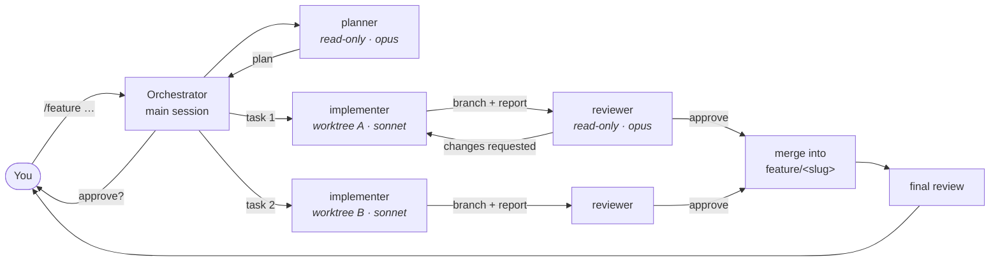

# claude-multiagent-workflow

A drop-in `.claude/` setup for [Claude Code](https://code.claude.com/docs) that
splits a coding task across specialised agents: a **planner** that breaks the
work down, **implementers** that each build one piece in their own git
worktree in parallel, and an independent **reviewer** that checks every piece
against a review checklist your team keeps in git.

It's all Markdown and JSON. Commit it, and every teammate who opens the repo
in Claude Code gets the same agents, the same `/feature` command and the same
review bar.

```text
> /feature add rate limiting to the public API

● planner      → 3 tasks: T1 limiter core · T2 middleware (needs T1) · T3 config + docs
  [you approve the plan]
● implementer  T1 ─┐  worktree .claude/worktrees/agent-…  ✓ committed
● implementer  T3 ─┘  worktree .claude/worktrees/agent-…  ✓ committed   (in parallel)
● reviewer     T1 APPROVE · T3 CHANGES_REQUESTED → fixed → APPROVE
● merge T1, T3 → feature/rate-limiting · tests pass
● implementer  T2 … reviewer APPROVE … merge
● reviewer     whole feature: APPROVE, 2 should-fix notes
  Ready on feature/rate-limiting. Nothing pushed.
```
<sub>Illustrative transcript, shortened.</sub>

## Why

One long Claude session doing everything has three problems:

1. **Context fills up.** Planning, exploring, editing ten files and debugging
   tests all compete for one context window. By the end, the early decisions
   are fuzzy.
2. **Self-review is weak.** The session that wrote the code is the one least
   likely to see what's wrong with it.
3. **It's serial.** Independent pieces of a feature wait for each other.

This setup gives each concern its own agent with a fresh context, runs
independent work concurrently in isolated checkouts, and puts a human
checkpoint where it's cheapest: on the plan, before any code is written.

## How it works



- **Worktree per task.** Each implementer runs with `isolation: worktree`: a
  separate checkout on its own branch, sharing the same `.git`. Parallel
  agents can't overwrite each other's files or trip over each other's
  half-finished changes. Task branches are visible to the orchestrator right
  away, so it reviews and merges them without pushing anything.
- **Contracts, not conversations.** The planner emits tasks with an exact
  file scope and checkable acceptance criteria. Implementers return a fixed
  report (branch, commit, checks). The reviewer returns a verdict with
  `file:line` findings. The orchestrator works from these, so its own context
  stays small.
- **Read-only judges.** The planner and reviewer can't edit files. The reviewer
  never sees the reasoning that produced the code, only the diff, the task
  and the checklist.
- **Humans hold the gates.** You approve the plan. Nothing is pushed and no
  PR is opened unless you ask. A hook blocks force pushes, pushes to
  protected branches, `reset --hard` and similar commands for every agent.

Details: [docs/workflow.md](docs/workflow.md).

## What's inside

```text
CLAUDE.md                     project memory every agent reads; fill in your commands
.claude/
├── agents/
│   ├── planner.md            feature → tasks with file scopes + acceptance criteria
│   ├── implementer.md        builds one task in its own worktree, commits, reports
│   └── reviewer.md           reviews a diff against the checklist; APPROVE / CHANGES_REQUESTED
├── skills/
│   ├── feature/SKILL.md      /feature   plan → parallel build → review → integrate
│   ├── delegate/SKILL.md     /delegate  one task in a worktree + review, while you keep working
│   ├── review/SKILL.md       /review    run the reviewer on a branch, range or your changes
│   └── tidy/SKILL.md         /tidy      list and safely remove finished worktrees
├── review/
│   ├── checklist.md          the team's review bar; edit it in a PR
│   └── security.md           extra pass when a diff touches auth, input, shell, deps…
├── hooks/guard-git.sh        blocks destructive/publishing git commands for all agents
└── settings.json             permissions, hook wiring, worktree base
.worktreeinclude              gitignored files (.env…) copied into new worktrees
scripts/install.sh            add this setup to an existing repo without overwriting
scripts/validate.py           CI check that agents, skills and settings are well formed
docs/                         workflow reference and customization guide
```

## Quick start

**Requirements:** a recent Claude Code (subagent `isolation: worktree` and
`claude --worktree` must be supported), git, and bash. The hook uses `jq` or
`python3` if one is installed.

### New project

Click **Use this template** on GitHub, or:

```bash
git clone https://github.com/ZeroSudoSpell/claude-multiagent-workflow my-project
```

### Existing project

```bash
git clone --depth 1 https://github.com/ZeroSudoSpell/claude-multiagent-workflow /tmp/cmw
```

```bash
/tmp/cmw/scripts/install.sh /path/to/your/repo
```

The installer never overwrites a file. If you already have a `CLAUDE.md` or
`.claude/settings.json`, it lists what to merge by hand.

### Then

1. Fill in the **Commands** table in `CLAUDE.md`: test, lint, format. Agents
   run exactly what's there.
2. Optionally add your test and lint commands to `permissions.allow` in
   `.claude/settings.json` so implementers don't stop to ask.
3. Commit `.claude/`, `CLAUDE.md` and `.worktreeinclude`.
4. Open the repo in Claude Code interactively once and accept the
   workspace trust prompt. Until you do, Claude Code ignores the project's
   `settings.json` permissions.
5. Try it, smallest first:

   ```text
   /review                          review your current branch
   /delegate add a test for the empty-input case in parse_config
   /feature  <a real, multi-file change>
   ```

## Sharing with your team

| Committed (shared) | Personal (gitignored) |
|---|---|
| `.claude/agents/`, `.claude/skills/`, `.claude/review/`, `.claude/hooks/` | `.claude/settings.local.json` |
| `.claude/settings.json` | `CLAUDE.local.md` |
| `CLAUDE.md`, `.worktreeinclude` | `.claude/worktrees/` |

- **The review bar is code.** Disagree with how the reviewer judges? Change
  `.claude/review/checklist.md` in a PR, get it reviewed like anything else,
  and every teammate's reviews change on their next pull.
- **Agent fixes compound.** When an agent keeps getting something wrong, a
  one-line fix to `CLAUDE.md` or the agent file fixes it for everyone.
- **CI keeps it working.** `.github/workflows/validate.yml` validates agent
  and skill frontmatter, checks that hooks exist and are executable, runs the
  guard hook's test table, tests the installer, and runs shellcheck.

## Design choices

- **Why worktrees, not just branches?** Branches share one working directory,
  so two agents on two branches still overwrite each other's files. Worktrees
  give each agent its own directory on the same repository. It's cheap and
  local, and nothing has to be pushed for the orchestrator to see the result.
- **Why a separate reviewer?** Independence. A fresh context that sees only
  the diff, the task and the checklist catches things the author's context
  rationalised away. Making it read-only keeps it a judge, not a second
  author.
- **Why stop at the plan?** It's the cheapest place to catch a
  misunderstanding: before several agents spend tokens building it.
- **Why mixed models?** Planning and reviewing are judgment-heavy and happen
  once per task; implementing is tightly scoped and happens many times in
  parallel. Swap them in each agent's `model:` field.
- **Why not agent teams?** Claude Code's agent teams are experimental and
  interactive-only. Plain subagents plus worktrees work everywhere, and a
  single orchestrator means one place where you approve things.

## Limits and costs

- **Parallel agents multiply token use.** `/feature` with four tasks runs
  roughly six to ten agent contexts. Use `/delegate` or a plain session for
  small changes.
- **Each worktree is a full checkout.** Dependencies such as `node_modules`
  or a virtualenv aren't shared. Implementers run your install command first,
  so make it fast, or add a setup step to `CLAUDE.md`.
- **Good plans need clean seams.** If the planner can't split a change
  without two tasks touching the same file, you get one bigger task, which is
  the right call.
- **The git guard is a guardrail, not a sandbox.** See
  [docs/customizing.md](docs/customizing.md#the-git-guard).

## Customize

Models, extra agents, project review rules, permissions, a format-on-save
hook, protected branches: [docs/customizing.md](docs/customizing.md).

## License

[MIT](LICENSE)
